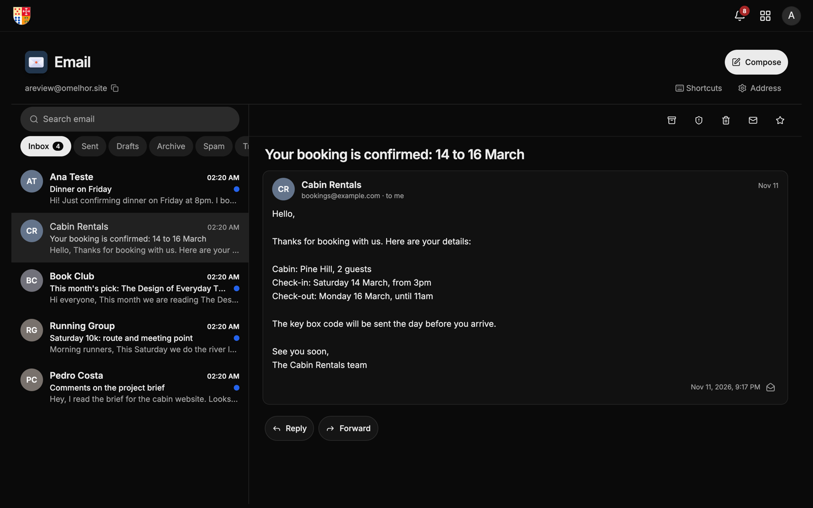
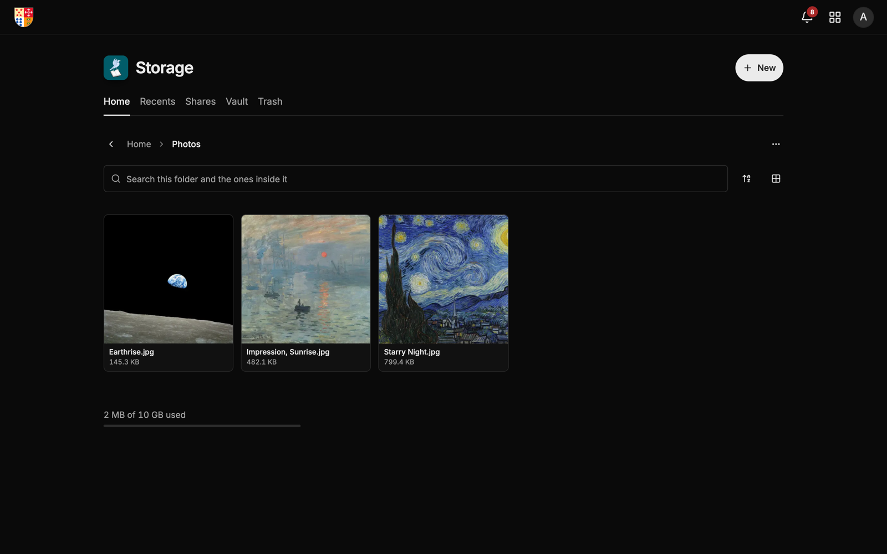
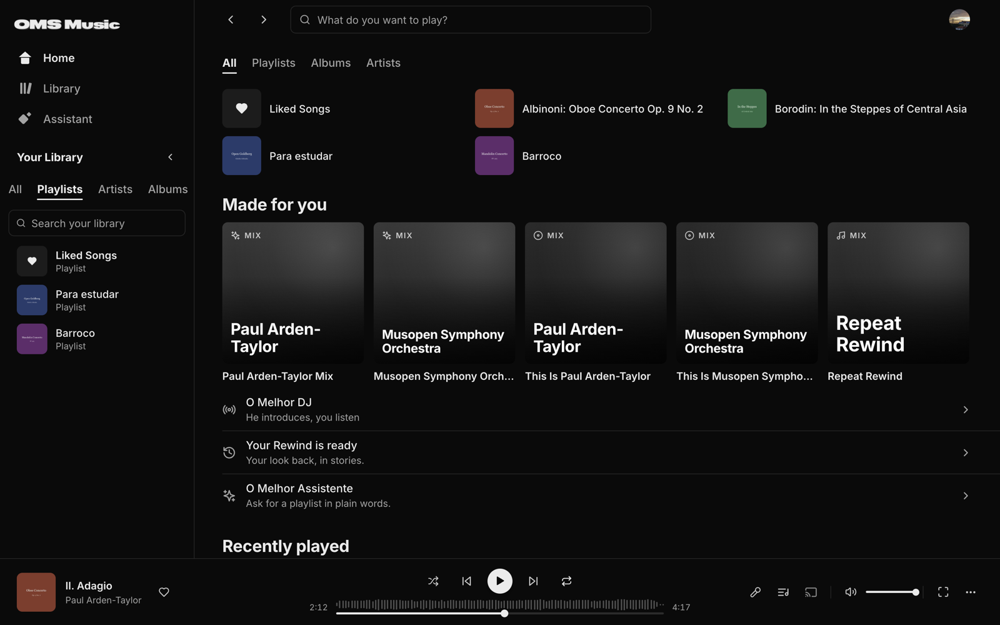
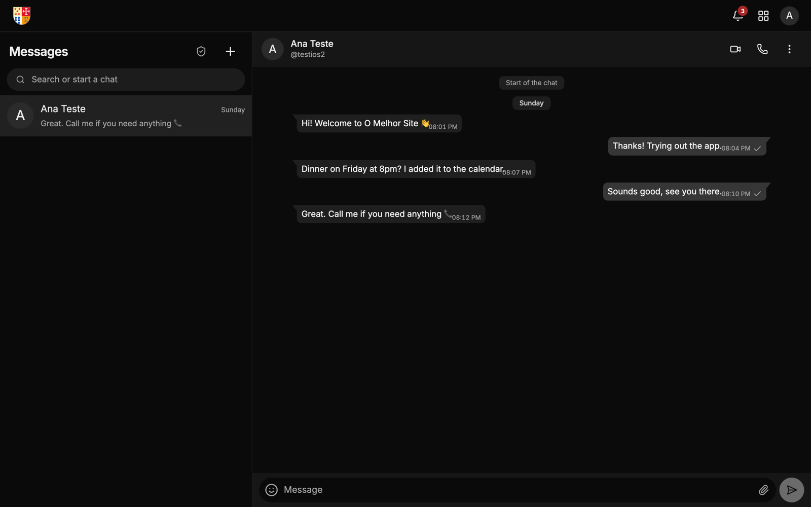
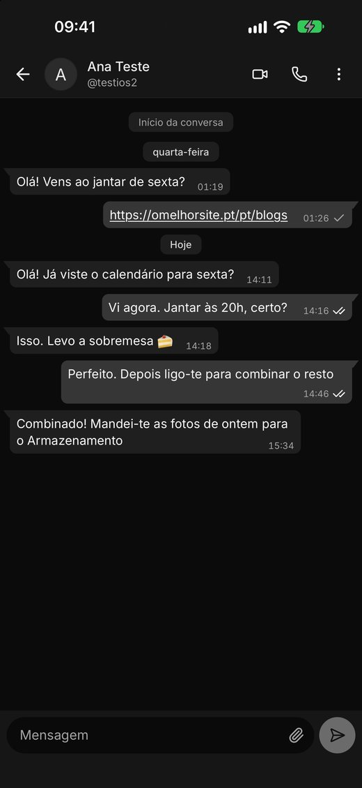
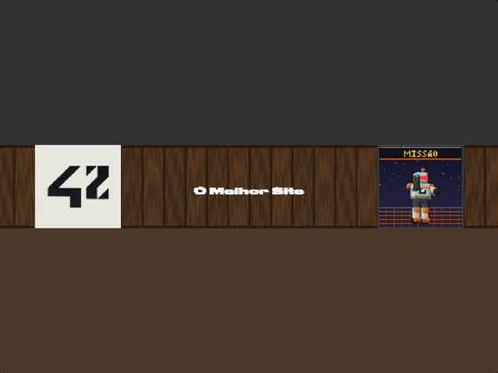

# Afonso Coutinho

[afonso@omelhorsite.pt](mailto:afonso@omelhorsite.pt) · [LinkedIn](https://www.linkedin.com/in/afonsopc) · [omelhorsite.pt](https://omelhorsite.pt)

4+ years building software: web apps, APIs and system integrations such as company-wide dashboards, expense management with automated document generation, real-time error workflows and internal documentation tools. I like working at both ends of the stack, from polished web interfaces to low-level systems code, and I ship and maintain everything myself: the code, the servers it runs on and the App Store releases.

## omelhorsite.pt

A platform I build and run myself, on my own servers in Portugal, with apps for iPhone and Android.

[](https://apps.apple.com/app/id6830411809)

<table>
<tr>
<td width="50%"><br><b>Email</b> · an <code>@omelhor.site</code> address with its own inbox</td>
<td width="50%"><br><b>Storage</b> · files and folders, share links, trash and an encrypted vault</td>
</tr>
<tr>
<td><br><b><a href="https://music.omelhorsite.pt">OMS Music</a></b> · its own music app: library, playlists and mixes</td>
<td><br><b>Messages and calls</b> · end-to-end encrypted, voice and video</td>
</tr>
</table>



**On iPhone** the messages and calls are native: calls ring through CallKit like a normal phone call.

### For agents

Everything is reachable from a terminal or an AI agent, with the same account:

- **CLI** · [`@omelhorsite/cli`](https://www.npmjs.com/package/@omelhorsite/cli), prints JSON when piped and has a stable exit code contract  
  `brew tap afonsopc/oms https://github.com/afonsopc/homebrew-oms && brew install oms` (also on a [signed APT repository](https://github.com/afonsopc/oms-packages) and npm)
- **MCP server** · [`@omelhorsite/mcp`](https://www.npmjs.com/package/@omelhorsite/mcp), two tools (`search` and `execute`): the model reads the SDK types and writes TypeScript against them  
  `claude mcp add omelhorsite --env OMS_TOKEN=... -- bunx @omelhorsite/mcp`
- **SDK** · [`@omelhorsite/sdk`](https://github.com/afonsopc/omelhorsite-sdk), TypeScript, runs in browsers, Node, Bun and Cloudflare Workers

```sh
oms auth login
oms storage ls /
oms storage put report.pdf --to /Documents
```

<br clear="right">

## Other projects

- **[Tune Shifter](https://github.com/afonsopc/tune-shifter)** · change the speed and pitch of any audio or video on the web, with reverb and volume control on desktop  
[](https://apps.apple.com/app/id6832348789)
[](https://chromewebstore.google.com/detail/tune-shifter/empnmbaeakhblbiffifgmojmkjiflklp)
[](https://addons.mozilla.org/en-US/firefox/addon/tune-shifter)
- **[cub3D](https://github.com/afonsopc/cub3d)** · 3D raycasting game in plain C (42 project) · [play it in the browser](https://omelhorsite.pt/games/cub3d)  

- **[webserv](https://github.com/afonsopc/webserv)** · HTTP web server from scratch in C++ (42 project)
- **[minishell](https://github.com/afonsopc/minishell)** · bash-like shell in C (42 project)
